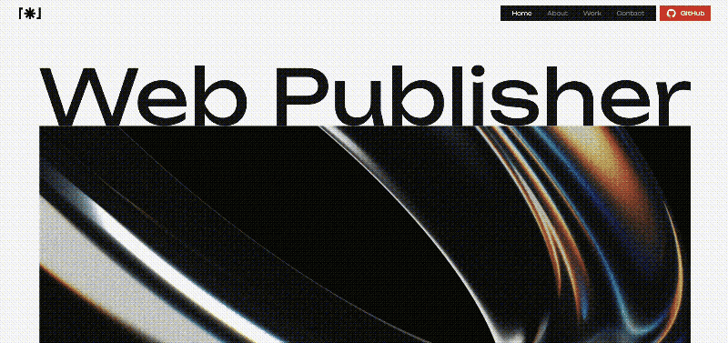
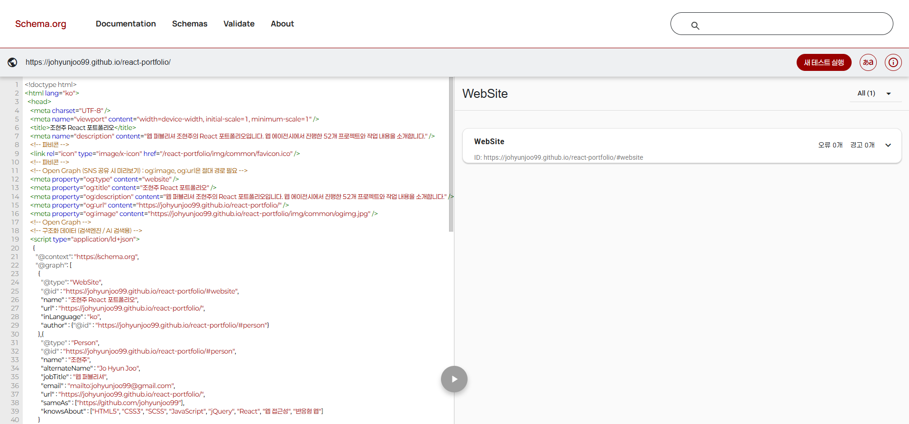

# React Portfolio

웹 퍼블리셔 조현주의 개인 포트폴리오 웹사이트입니다.
웹 에이전시에서의 퍼블리싱 경험을 바탕으로 React를 활용해 직접 설계하고 구현하며, 구조적인 UI 구성과 유지보수성을 고려한 웹사이트 제작을 목표로 합니다.

- **사이트** : https://johyunjoo99.github.io/react-portfolio/
- **경력기술서** : [조현주_경력기술서.pdf](https://johyunjoo99.github.io/react-portfolio/file/%EC%A1%B0%ED%98%84%EC%A3%BC_%EA%B2%BD%EB%A0%A5%EA%B8%B0%EC%88%A0%EC%84%9C.pdf)


## 미리보기




## 프로젝트 소개

실무에서는 HTML / CSS / jQuery 기반으로 퍼블리싱해 왔으며, 이 포트폴리오는 **React로 직접 설계하고 구현한 첫 프로젝트**입니다.
웹 에이전시에서 진행한 52개 프로젝트를 데이터로 구조화하고, 메인 페이지의 스크롤 인터랙션부터 서브 페이지의 검색 / 필터 / 상세 팝업까지 직접 구현했습니다.

- **기간** : 2026.08.31 ~ 2026.10.14 (이후 지속 개선)
- **인원** : 1인 (디자인 · 퍼블리싱 · 개발)

### 진행 상황

| 구분 | 내용 | 상태 |
|---|---|---|
| 메인 페이지 | Hero / About / Project / Contact | 완료 |
| 공통 영역 | Header / Footer / Floating / 반응형 | 완료 |
| 서브 페이지 (Work) | 프로젝트 검색 / 필터 / 정렬 / 더보기 / 상세 팝업 | 완료 |
| 메인 → 서브 연결 | 메인 `VIEW MORE` 및 대표 프로젝트에서 Work 페이지 / 상세 팝업으로 연결 | 완료 |


## 주요 기능

### 공통
- PC / 태블릿 / 모바일 반응형 레이아웃
- 스크롤 위치에 따른 현재 메뉴 활성화 및 섹션 이동
- 모바일 전체 메뉴 및 TOP 버튼
- Footer 경력기술서 / GitHub 바로가기

### 메인 페이지
- **Hero** : 스크롤 진행도에 따라 타이틀과 배경이 전환되는 인터랙션, SVG 텍스트 순차 등장 애니메이션
- **About** : 숫자 자리별 롤링 카운터
- **Project** : 스크롤에 따라 대표 프로젝트가 순서대로 쌓이는 레이아웃, 대표 프로젝트 상세 팝업 연결
- **Contact** : 스크롤 진입 애니메이션

### 서브 페이지 (Work)
- 전체 / 제목 / 내용 기준 프로젝트 검색
- 개발 환경 / 작업 언어 / 대표 색상 필터
- 최신순(종료일 기준) / 오래된순(시작일 기준) / 제목순 정렬 및 10개 단위 더보기
- 프로젝트별 메인 / 서브 참여도 표시
- 프로젝트 상세 팝업 및 `/work/프로젝트ID` URL 연동 (직접 접속 / 새로고침 / 뒤로가기 지원)


## Tech Stack

### Development
- HTML5
- SCSS
- JavaScript
- React
- Vite

### Library
- **React Router** : SPA 라우팅 및 URL 기반 팝업 상태 관리
- **react-select** : 커스텀 스타일을 적용한 Select UI
- **AOS** : 스크롤 진입 애니메이션

### Deploy
- GitHub Pages
- GitHub Actions (main 브랜치 push 시 자동 빌드 / 배포)

### Tools
- Figma
- Git
- GitHub
- Cursor


## 구현 포인트

포트폴리오이지만 **"실제 운영되는 사이트에 들어갈 기능"** 이라는 기준으로 작업했습니다.
콘텐츠가 늘어나거나 화면 크기가 바뀌어도 레이아웃이 흔들리지 않을 것, 관리하는 사람이 같은 내용을 반복해서 수정하지 않아도 될 것을 가장 우선했습니다.

### 유지보수성

**하나의 데이터로 관리하는 프로젝트 정보**
- 같은 내용을 여러 곳에 반복 입력하는 구조는 관리하는 입장에서 비효율적이라고 판단해, 처음부터 하나의 데이터로 관리하는 것을 목표로 했습니다.
- 작업 순서(메인 → 서브 리스트 → 상세 팝업)에 맞춰 메인용 데이터 구조를 먼저 만들고, 이를 기반으로 리스트와 상세 정보까지 범위를 넓혀 `projectData` 하나로 통합했습니다.
- 메인 대표 프로젝트, Work 리스트, 상세 팝업, About 카운터의 프로젝트 수, 서브 페이지 설명 문구까지 모두 같은 데이터를 사용합니다. 프로젝트를 추가할 때는 데이터만 추가하면 됩니다.

**수치만 바꾸면 되는 카운터 컴포넌트**
- 숫자나 자릿수가 바뀔 때마다 마크업을 다시 손보지 않도록, 숫자 문자열만 전달하면 자릿수에 맞춰 롤링 구조가 자동으로 만들어지게 구현했습니다.
- 이전 직장에서 jQuery로 만들어 사용하던 방식을 React 컴포넌트(`AboutNumber`)로 옮겼습니다.

### 레이아웃 안정성

**CSS 변수 기반 스크롤 인터랙션 (Hero)**
- 스크롤 인터랙션을 JS 라이브러리(ScrollTrigger 등)로 구성하면 요소의 위치와 크기를 스크립트로 계산하기 때문에, 화면 크기가 바뀌면 다시 계산해야 해서 새로고침이 필요한 경우가 많았습니다. 이를 피하기 위해 새로고침 시 최상단으로 이동시키는 방식은 사용자에게 불편을 준다고 판단했습니다.
- 그래서 스크립트는 인터랙션 구간의 스크롤 진행도(0 → 100, 100 → 0)만 계산해 CSS 변수로 전달하고, 실제 크기와 위치는 CSS에서 `calc()`로 계산하도록 역할을 나눴습니다. 레이아웃 계산을 CSS가 맡기 때문에 화면 크기가 바뀌어도 별도의 재계산 없이 반응형이 유지됩니다.
- 이전 직장에서 실제 프로젝트에 적용했던 방식을 React 환경으로 옮겼습니다. `useRef`로 요소에 직접 CSS 변수를 갱신해 스크롤마다 리렌더가 발생하지 않도록 했고, `requestAnimationFrame`으로 목표값까지 부드럽게 따라가는 이징을 적용했습니다.

**스크롤바를 제외한 화면 너비 변수 (`--vw`)**
- 인터랙션은 현재 화면 너비를 기준으로 계산해야 하는 경우가 많은데, `100vw`는 스크롤바 너비까지 포함해 가로 스크롤이 생깁니다.
- 스크롤바를 제외한 실제 너비(`clientWidth`)를 CSS 변수 `--vw`로 제공하고, 화면 크기가 바뀌면 다시 계산하도록 했습니다. (`useViewport`)

**숫자 너비 고정 (`tabular-nums`)**
- 기본 폰트는 숫자마다 너비가 달라, 목록의 번호나 기간처럼 숫자가 세로로 나열되면 정돈되어 보이지 않습니다. 실무에서도 고객사로부터 종종 지적받던 부분이고, 숫자가 계속 바뀌는 카운터에서는 더 눈에 띕니다.
- `font-variant-numeric: tabular-nums`로 숫자 너비를 고정해 정렬이 흐트러지지 않도록 했습니다.

### 사용성

**팝업 열림 시 배경 스크롤 잠금**
- 팝업 안의 스크롤이 끝까지 내려간 뒤 뒤쪽 페이지가 이어서 스크롤되면, 사용자는 보던 위치를 잃게 됩니다.
- 이전 직장에서 작업할 때부터 팝업이 열리면 body 스크롤을 잠그는 방식을 기본으로 적용해 왔고, 이번 프로젝트에도 같은 기준을 적용했습니다. 팝업이 닫히거나 페이지를 벗어나면 잠금이 해제됩니다.

**URL로 공유할 수 있는 상세 팝업**
- 이전 직장에서 팝업으로 제공되는 콘텐츠에 대해 "팝업이 열린 상태로 접속되는 URL"을 요청받은 사례를 보며, 운영 중인 사이트에서는 이런 기능이 필요할 수 있다고 생각했습니다.
- 이미지 검색에 자주 사용하던 Unsplash에서 팝업이 열리면 주소에 ID가 붙고, 그 주소로 접속하면 팝업이 열린 상태로 진입하는 방식을 사용자로서 편리하게 느껴 이번 프로젝트에 적용했습니다.
- 상세 팝업이 열리면 `/work/프로젝트ID`로 주소가 바뀌고, 직접 접속 / 새로고침 / 공유 시에도 같은 팝업이 열립니다. 브라우저 뒤로가기로 팝업을 닫을 수 있고, 팝업을 열고 닫아도 목록의 검색 / 필터 / 정렬 상태는 유지됩니다.

**기간의 의미에 맞춘 날짜 정렬**
- 처음에는 최신순 / 오래된순 모두 종료일을 기준으로 정렬했는데, 기간이 긴 프로젝트는 일찍 시작했어도 오래된순에서 중간에 노출되어 실제 작업 순서와 맞지 않았습니다.
- 최신순은 "가장 최근에 완료한 프로젝트", 오래된순은 "가장 먼저 시작한 프로젝트"가 앞에 오도록 각각 종료일 / 시작일을 기준으로 나눴습니다. 목록에 기간이 `시작 - 종료`로 표시되기 때문에, 정렬에 따라 기준이 되는 날짜가 순서대로 나열되어 보입니다.
- 날짜가 같은 프로젝트는 나머지 날짜로 한 번 더 비교해, 데이터 입력 순서와 관계없이 항상 같은 순서로 노출되도록 했습니다.


## 트러블슈팅

### GitHub Pages 서브 경로 배포
**문제**
- 첫 배포 시 흰 화면만 보였고, 이를 해결한 뒤에는 이미지가 표시되지 않았습니다.
- 이후 모바일에서 개발 중인 서브 페이지를 확인하려고 URL을 직접 입력해 접속하자 404 페이지가 나타났습니다.

**원인**
- GitHub Pages는 `/react-portfolio/` 하위 경로에 배포되는데, Vite와 React Router는 기본적으로 도메인 루트(`/`)를 기준으로 동작합니다.
- 이미지는 처음에 `src/img`에 두고 사용하다가, 루트 기준으로 경로를 작성하는 편이 찾고 관리하기 쉽다고 판단해 `public/img`로 옮겨 `/img/...` 형태로 작성했습니다. 이 루트 기준 경로가 하위 경로 배포 환경에서는 도메인 루트를 가리켜 이미지를 찾지 못했습니다.
- GitHub Pages는 정적 호스팅이라 `/react-portfolio/work`처럼 실제 파일이 없는 경로로 직접 접속하면 404를 반환합니다.

**해결**
- Vite `base`와 React Router `basename`을 배포 경로에 맞췄습니다.
- 이미지는 `public` 기준의 경로 구조를 그대로 유지하고, 앞에 배포 경로(`import.meta.env.BASE_URL`)를 붙이는 공통 상수를 만들어 사용하도록 변경했습니다. 배포 경로가 바뀌어도 이미지 경로는 Vite `base` 설정만 수정하면 함께 바뀝니다.
- `404.html`에서 요청 경로를 저장한 뒤 `index.html`로 이동시키고, 앱이 시작되기 전에 `history.replaceState`로 원래 경로를 복원하도록 했습니다.
- 이 처리 덕분에 이후 추가한 `/work/프로젝트ID` 형태의 상세 팝업 URL도 직접 접속이 가능합니다.

### iOS Safari에서 팝업 하단이 잘리는 문제
**문제**
- iPhone 16 Safari에서 프로젝트 상세 팝업의 하단이 브라우저 툴바에 가려 잘려 보였고, 팝업 안을 끝까지 스크롤해도 하단 내용이 보이지 않았습니다.

**원인**
- 모바일 Safari의 `vh`는 주소창과 하단 툴바가 숨겨진 상태의 높이를 기준으로 계산되어, 툴바가 보이는 상태에서는 실제 화면보다 커집니다.

**해결**
- 팝업 최대 높이를 `80vh`에서 브라우저 UI 변화를 반영하는 `80dvh`로 변경했습니다.

### 모바일에서 겹쳐지는 프로젝트 영역 우측에 이전 항목이 비치는 문제
**문제**
- 메인 Project 영역은 스크롤에 따라 항목이 겹쳐지며 쌓이는 구조인데, 모바일에서 화면 우측 끝에 이전 항목의 이미지가 살짝 비쳐 보였습니다.

**원인**
- 콘텐츠 최대 너비와 좌우 여백을 담당하는 이너(`.w1700`)가 전체 항목을 감싸고 있어, 각 항목의 너비가 화면 전체가 아닌 이너 안쪽으로 제한되었습니다. 그 결과 새로 겹쳐지는 항목이 좌우 여백 영역까지 덮지 못해, 그 틈으로 이전 항목의 이미지가 보였습니다.

**해결**
- 각 항목은 화면 전체 너비를 차지하도록 하고, 이너는 항목 내부의 타이틀 / 콘텐츠 영역에 각각 적용하도록 마크업 구조를 변경했습니다.

### 페이지 이동 시 AOS 애니메이션이 미리 실행되는 문제
**문제**
- 메인 페이지를 스크롤한 상태에서 Work 페이지로 이동하면, 화면 아래에 있는 프로젝트 목록의 등장 애니메이션이 이미 끝난 상태로 보였습니다.
- `/work`로 직접 접속하거나 메인 최상단에서 이동할 때는 정상적으로 동작했습니다.

**원인**
- AOS는 새로 추가된 요소를 감지하면 바로 현재 스크롤 위치를 기준으로 노출 여부를 판단합니다.
- 페이지 이동 시 스크롤 초기화를 `useEffect`에서 처리하고 있어, AOS가 판단하는 시점에는 아직 이전 페이지(메인)의 스크롤 위치가 남아 있었습니다. 그 결과 화면 아래의 요소를 이미 지나간 요소로 판단해 애니메이션을 바로 실행했습니다.

**해결**
- 스크롤 초기화를 DOM 변경 직후, 브라우저가 화면을 그리기 전에 실행되는 `useLayoutEffect`로 변경해, AOS가 초기화된 스크롤 위치를 기준으로 판단하도록 했습니다.


## 웹 접근성

실무 프로젝트에서는 웹 접근성 인증 수준의 대응이 요구되지 않았지만, 이번 작업에서는 기본 접근성 항목을 직접 점검하고 적용했습니다.

- 이미지 대체 텍스트 및 아이콘 버튼의 숨김 텍스트 제공
- 메뉴 / 검색 필터 토글 버튼의 열림 상태 전달 (`aria-expanded`, `aria-controls`)
- 닫혀 있는 메뉴 / 검색 필터 / 팝업의 키보드 포커스 차단 (`inert`)
- 레이어 팝업 `role="dialog"` 적용, 포커스 이동 / 포커스 트랩 / ESC 닫기 / 닫힘 시 포커스 복귀
- 모바일 전체 메뉴 열림 시 뒤쪽 콘텐츠 `inert` 처리로 포커스를 메뉴 영역 안으로 제한, 닫힘 시 메뉴 버튼으로 포커스 복귀
- 검색 입력 및 Select 영역 label 연결
- 글자 단위 애니메이션 텍스트의 스크린리더 대응
- 동작 줄이기(`prefers-reduced-motion`) 설정 시 애니메이션 / 스크롤 전환 최소화
- 키보드 탐색 시 포커스 표시 (`:focus-visible`)
- 새 창으로 열리는 링크 안내


## SEO / GEO

검색엔진뿐 아니라 생성형 AI 검색에서도 사이트 정보를 정확하게 이해할 수 있도록 구조화 데이터를 적용했습니다.

**문제**
- 이 사이트는 React 기반 CSR(클라이언트 렌더링) 구조라, 서버가 내려주는 HTML에는 빈 `<div id="root"></div>`만 있고 본문은 JavaScript 실행 후에 그려집니다.
- JavaScript를 실행하지 않는 크롤러가 받는 초기 HTML을 확인하기 위해 GPTBot User-Agent로 `curl` 요청을 보낸 결과, `title` / `meta description` / Open Graph 외에 본문은 포함되어 있지 않았습니다.

**적용**
- React 컴포넌트 안에서 렌더링하면 JavaScript 실행 전에는 보이지 않기 때문에, 구조화 데이터(JSON-LD)를 `index.html`의 `<head>`에 직접 작성했습니다.
- Schema.org 어휘를 사용해 `WebSite`(사이트 정보)와 `Person`(제작자 정보)을 정의했습니다.
- `@id`로 각 대상에 고유 식별자를 부여하고, `WebSite`의 `author`가 `Person`을 가리키도록 연결해 "이 사이트의 제작자가 누구인지"를 명시했습니다.
- `alternateName`으로 국문 / 영문 이름을 같은 사람으로 연결하고, `sameAs`로 GitHub 계정을 연결했습니다.
- JSON-LD는 본문을 대신 제공하는 것이 아니라, 본문이 없는 초기 HTML에서도 사이트와 제작자 정보를 전달하기 위한 보완책입니다.

```json
{
  "@context": "https://schema.org",
  "@graph": [
    {
      "@type": "WebSite",
      "@id": ".../react-portfolio/#website",
      "author": { "@id": ".../react-portfolio/#person" }
    },
    {
      "@type": "Person",
      "@id": ".../react-portfolio/#person",
      "name": "조현주",
      "alternateName": "Jo Hyun Joo",
      "jobTitle": "웹 퍼블리셔",
      "sameAs": ["https://github.com/johyunjoo99"],
      "knowsAbout": ["HTML5", "CSS3", "SCSS", "JavaScript", "jQuery", "React", "웹 접근성", "반응형 웹"]
    }
  ]
}
```

**검증**
- [Schema Markup Validator](https://validator.schema.org/)로 문법과 Schema.org 속성 인식 여부를 확인했습니다.
- `@id` 연결에 따라 `Person`이 `WebSite`의 `author`로 인식되는 것을 확인했습니다.
- 배포 후 실제 URL 기준으로 오류 / 경고 0개를 확인했습니다.
- 배포 후 `curl`로 초기 HTML을 받아 JSON-LD가 포함된 것을 확인했고, 일반 요청과 GPTBot User-Agent 요청의 응답이 동일한 것도 확인했습니다.



**한계 및 개선 방향**
- `/work` 등 하위 경로는 `404.html` 우회 방식으로 접속되기 때문에, 크롤러에게는 HTTP 404로 응답되어 색인되지 않습니다. (`curl`로 응답 코드 확인)
- `robots.txt`는 도메인 최상위에 있어야 적용되는데, 이 사이트는 GitHub Pages의 하위 경로(`/react-portfolio/`)에 배포되어 있어 프로젝트 안에서는 적용할 수 없습니다.
- 실제 운영 사이트라면 빌드 시점에 HTML을 생성하는 SSG / SSR 방식(Next.js 등)으로 페이지별 본문과 구조화 데이터를 함께 제공하는 것이 적합하다고 판단했습니다.


## 폴더 구조

```
src
├── component
│   ├── board     # 검색 / 필터 / 정렬 / 레이어 팝업 등 게시판 공통 컴포넌트
│   ├── common    # Header / Nav / Footer / Floating 등 공통 컴포넌트
│   ├── main      # 메인 페이지 섹션 컴포넌트
│   ├── sub       # 서브 페이지 공통 레이아웃
│   ├── svg       # SVG 컴포넌트
│   └── work      # Work 페이지 컴포넌트
├── constants     # 공통 상수
├── data          # 프로젝트 / 검색 필터 / 메뉴 데이터
├── hooks         # 커스텀 Hook
├── pages         # 페이지 컴포넌트 (Main / Work)
└── style         # SCSS (변수 / 믹스인 / 공통 / 페이지별 스타일)
```


## 실행 방법

```bash
npm install
npm run dev
```


## 개발 로그

<details>
<summary>날짜별 개발 로그 보기</summary>

#### 2026.08.31
**프로젝트 환경 구성**
- Vite 기반 React 프로젝트 생성
- SCSS 설치 및 기본 파일 구성
- `src` / `public` 폴더 구조 구성
- 공통 이미지 및 favicon 연결
- Open Graph 대표 이미지 설정
- `index.html` title 및 meta 정보 설정
- 480px 이하 모바일 viewport 대응

#### 2026.09.01
**Header 구현**
- 컴포넌트 구현
- 레이아웃 및 네비게이션 구성

**Hero 영역 초기 구조 구성**
- 컴포넌트 기본 구조 구성
- SVG 컴포넌트 연결
- 스크롤 인터랙션을 위한 초기 구조 구성

#### 2026.09.02
**Hero 영역 구현**
- 영역 레이아웃 및 스타일 구현
- SVG 기반 타이포그래피 적용
- `useRef`와 `requestAnimationFrame`을 활용한 스크롤 인터랙션 구현
- CSS Custom Properties를 활용한 인터랙션 값 제어
- 반응형 환경을 고려한 SVG 크기 및 여백 계산

**About 영역 구현**
- 컴포넌트 기본 구조 구성
- 영역 레이아웃 및 스타일 구현

#### 2026.09.03
**About 영역 카운터 인터랙션 구현**
- 숫자 데이터 기반 카운터 구조 구현
- `AboutNumber` 컴포넌트 분리
- 숫자 자리별 롤링 인터랙션 구현
- AOS를 활용한 인터랙션 실행 시점 제어

**Project 영역 초기 구조 구성**
- 컴포넌트 기본 구조 구성
- 프로젝트 아이템 기본 마크업 구성
- 프로젝트 정보 및 이미지 영역 구성
- 프로젝트 기술 스택 및 링크 영역 구성

#### 2026.09.04
**Project 영역 구현**
- 대표 프로젝트 데이터 및 목록 구조 구성
- 프로젝트 정보, 기술 스택, 외부 링크 데이터화
- 프로젝트 목록 동적 렌더링
- `useState`와 `scroll` 이벤트를 활용한 활성 프로젝트 상태 관리
- 스크롤 위치에 따른 프로젝트 활성 상태 및 이전 프로젝트 UI 제어
- 활성 프로젝트에 따른 `is-prev`, `is-active` 클래스 동적 적용
- `ProjectMore` 컴포넌트 분리 및 전체 프로젝트 연결

#### 2026.09.05
**Contact 영역 구현**
- Contact 컴포넌트 기본 구조 구성
- 영역 레이아웃 및 콘텐츠 스타일 구현

**Footer 컴포넌트 구현**
- Footer 컴포넌트 기본 구조 구성
- 영역 레이아웃 및 콘텐츠 스타일 구현

**Nav 컴포넌트 분리**
- Header 내부 Nav 영역 컴포넌트 분리
- 전체 메뉴에서 재사용할 수 있도록 공통 컴포넌트화

**Floating Menu 구현**
- Floating 영역 및 Top 버튼 구현
- 스크롤 위치에 따른 Top 버튼 노출 처리
- `#wrap` 기준으로 Floating 영역 적용 범위 설정

#### 2026.09.07
**TOP 버튼 hover 인터랙션 구현**
- CSS keyframes를 활용한 아이콘 전환 애니메이션 적용

**AOS 인터랙션 적용**
- 주요 콘텐츠 영역에 스크롤 애니메이션 적용

**Header 반응형 구현**
- PC / 모바일 환경에 따른 Header 레이아웃 대응
- 모바일 메뉴 컴포넌트 구성
- 햄버거 버튼을 통한 모바일 메뉴 열기 / 닫기 구현
- 메뉴 외부 영역 및 메뉴 링크 클릭 시 메뉴 닫기 처리
- 스크롤 위치에 따른 현재 메뉴 활성화 구현
- 메뉴 클릭 시 해당 섹션으로 Smooth Scroll 이동 구현

**Hero 영역 반응형 구현**
- Media Query를 활용한 화면 크기별 Hero 스타일 대응

#### 2026.09.08
**About 영역 반응형 구현**
- Media Query를 활용한 화면 크기별 About 레이아웃 및 스타일 대응
- PC / 태블릿 / 모바일 환경에 따른 타이포 그래피 및 콘텐츠 배치 조정
- 모바일 환경에서 Counter 영역 1열 레이아웃으로 변경
- 반응형 환경에 맞춘 AOS 인터랙션 조정

**Project 영역 반응형 구현**
- Media Query를 활용한 화면 크기별 Project 레이아웃 및 스타일 대응
- PC 환경의 2열 구조에서 모바일 1열 구조로 레이아웃 변경
- 모바일 환경에 맞춘 프로젝트 콘텐츠 및 이미지 배치 조정
- 프로젝트 유형에 따른 반응형 레이아웃 차등 적용
- 모바일 환경에서 Project / More View 콘텐츠 흐름 최적화

**Contact / Footer / Floating 영역 반응형 구현**
- 화면 크기에 따른 Contact 콘텐츠 및 타이포그래피 조정
- 모바일 환경에서 Footer 콘텐츠 세로 배치 및 정렬 변경
- 화면 크기에 따른 Footer 로고 및 여백 조정
- 화면 크기에 따른 Floating 및 Top 버튼 크기 조정

#### 2026.09.10
**Hero SVG 텍스트 등장 인터랙션 구현**
- SVG path별 순차 등장 애니메이션 구현
- `translateY`와 `clip-path`를 활용한 텍스트 등장 효과 적용

#### 2026.09.14
**Sub Hero 영역 구현**
- 서브 페이지 공통 Hero 영역 레이아웃 및 스타일 구현
- 1차 메뉴별 페이지 정보에 따른 Hero 콘텐츠 및 비주얼 구분
- 서브 페이지 제목 및 LNB 영역 구성
- 화면 진입 시 Hero 이미지 및 텍스트 등장 인터랙션 구현
- `clip-path`와 `transform`을 활용한 Hero 이미지 전환 및 LNB 텍스트 등장 효과 적용

#### 2026.09.15
**Sub Hero 영역 수정**
- 서브 페이지 Hero 영역을 타이틀 중심의 심플한 구조로 수정
- 불필요한 Hero 비주얼 제거 및 페이지 타이틀 영역 정리
- 메인 페이지와 동일한 텍스트 등장 인터랙션 적용을 위한 구조 개선
- 텍스트를 글자 단위로 분리하고 animation-delay를 적용하는 `AnimateText` 컴포넌트 분리

**프로젝트 검색 및 필터 영역 구현**
- 프로젝트 검색창 UI 구현
- 개발 환경 / 다국어 / 대표 색상 필터 UI 구현
- 필터 초기화 및 적용 버튼 UI 구현
- 필터 옵션 데이터를 별도 파일로 분리하여 관리

#### 2026.09.16
**검색 필터 토글 기능 구현**
- 검색 필터 영역 접기/펼치기 기능 구현
- `scrollHeight`를 활용한 콘텐츠 높이 기반 애니메이션 적용

**게시판 공통 영역 구현**
- 게시판 전체 항목 수 정렬 영역 구성
- `react-select`를 활용한 정렬 select UI 구현
- 최신순 / 오래된순 / 제목 A-Z / 제목 Z-A 정렬 옵션 구성
- 정렬 Select 드롭다운 및 선택 상태 커스텀 스타일 적용

#### 2026.09.17
**프로젝트 검색 영역 수정**
- 검색 대상 선택을 위한 전체 / 제목 / 내용 Select 추가

**프로젝트 리스트 영역 구현**
- 프로젝트 데이터를 별도 파일로 분리하여 관리
- 프로젝트 데이터를 기반으로 리스트형 프로젝트 목록 출력
- 프로젝트별 대표 색상 및 색상 코드 연결
- 프로젝트별 작업 기간 정보 연결
- 개발 환경 및 기술 스택 정보를 하나의 목록으로 구성
- `map()`을 활용한 프로젝트 목록 동적 렌더링

#### 2026.09.18
**프로젝트 상세 팝업 기본 구조 및 레이아웃 구현**
- 프로젝트 상세 팝업 확인을 위한 레이어 팝업 기본 구조 구현
- 프로젝트 소개 및 개발 환경 / 기술 정보를 카드형 레이아웃으로 구성
- 기본 정보 / 주요 작업 / 작업 특징을 리스트형 레이아웃으로 구성
- 프로젝트별 참여도를 시각적으로 표현하기 위한 게이지 UI 구성
- 프로젝트별 공식 사이트 및 접수 사이트 이동 버튼 구성
- 프로젝트 상세 콘텐츠의 정보 성격에 따라 카드형 / 리스트형 레이아웃을 구분하여 구성

#### 2026.09.21
**프로젝트 카드 및 상세 팝업 UI 구현**
- 프로젝트 카드형 레이아웃 및 호버 인터랙션 구현
- 공통 더보기 버튼 `ViewMore.jsx` 컴포넌트화
- 프로젝트 상세 팝업을 위한 `LayerPopup` / `ProjectPopup` 컴포넌트 구조 구현
- 공통 팝업 영역과 프로젝트별 상세 콘텐츠 영역 분리

**프로젝트 상세 데이터 구조화 및 적용**
- 프로젝트 상세 정보를 데이터 형태로 구조화하여 관리
- 기존 Main 프로젝트 데이터와 상세 프로젝트 데이터를 통합하여 Main / Work 영역에서 공통 데이터 활용
- 대표 프로젝트 4개 상세 데이터 작성 및 팝업 연결
- 프로젝트별 개발 환경, 사용 기술, 기본 정보 및 주요 작업 데이터화
- 프로젝트별 작업 특징 및 특이 사항 데이터화
- 프로젝트 종료일을 기준으로 프로젝트 리스트 최신순 정렬 적용

#### 2026.09.22
**프로젝트 상세 데이터 등록 및 조건부 영역 노출**
- 프로젝트별 상세 정보 및 작업 내용 데이터 등록
- 프로젝트별 작업 특징 및 특이 사항 데이터 추가
- 특이 사항 데이터 유무에 따른 작업 특징 영역 조건부 렌더링 적용

**메인/서브 참여도 표시 UI 수정**
- 프로젝트별 메인/서브 참여도를 시각적으로 표현하는 UI 수정

**프로젝트 상세 데이터 추가**
- 프로젝트별 상세 정보 및 작업 특징 데이터 추가
- 프로젝트별 개발 환경, 사용 기술, 기본 정보 및 주요 작업 데이터 등록

#### 2026.09.29
**서브 페이지 공통 영역 반응형 구현**
- Media Query를 활용한 서브 페이지 공통 영역의 화면 크기별 스타일 대응
- 서브 히어로 영역의 반응형 레이아웃 및 타이포그래피 조정
- 서브 페이지 콘텐츠 영역의 상하단 여백 및 레이아웃 조정

**검색 및 필터 영역 반응형 구현**
- 화면 크기에 따른 검색 영역 레이아웃 및 스타일 조정
- 모바일 환경에서 Select와 검색 입력 영역을 분리하여 배치
- 검색 필터 슬라이딩 영역의 화면 크기별 레이아웃 및 여백 조정
- 화면 크기 변경에 따른 검색 필터 영역 높이 재계산

**프로젝트 리스트 반응형 구현**
- 화면 크기에 따른 프로젝트 리스트 레이아웃 및 스타일 조정
- 태블릿 및 모바일 환경에서 테이블 구조를 Grid 기반 리스트 형태로 변경
- 화면 크기에 따른 프로젝트 정보 배치 및 여백 조정
- 모바일 환경에서 프로젝트 상세 정보와 이동 요소의 배치 방식 변경

#### 2026.09.30
**프로젝트 상세 팝업 반응형 구현**
- Media Query를 활용한 프로젝트 상세 팝업의 화면 크기별 스타일 대응
- 화면 크기에 따른 팝업 내부 여백 및 콘텐츠 간격 조정
- 태블릿 및 모바일 환경에서 카드 및 상세 정보 영역의 레이아웃 변경
- 모바일 환경에서 상세 정보 및 참여도 표시 영역의 배치 방식 조정
- 화면 크기에 따른 타이포그래피 및 버튼 영역 크기 조정

**팝업 스크롤 및 모바일 대응 수정**
- 프로젝트 상세 팝업 열림 시 body 스크롤 잠금 처리
- 모바일 브라우저 UI 변화에 따른 팝업 영역 잘림 방지를 위해 dvh 적용

**검색 기능 구현**
- 전체 / 제목 / 내용 검색 조건 선택 기능 구현
- 검색 버튼 및 Enter 입력을 통한 검색 기능 구현
- 프로젝트 제목 및 소개 / 작업 내용 / 작업 특징을 기준으로 검색 결과 필터링

#### 2026.10.06
**프로젝트 검색 필터 기능 구현**
- 개발 환경 / 작업 언어 / 대표 색상을 기준으로 프로젝트 목록 필터링
- 작업 언어 다중 선택 및 전체 선택·해제 기능 구현
- 검색 기능과 검색 필터 조건을 연동하여 조건에 맞는 프로젝트 목록 출력

**프로젝트 정렬 기능 연동**
- 검색 및 필터 결과에 따른 프로젝트 총 개수 표시
- 최신순, 오래된순, 제목 A-Z, 제목 Z-A 정렬 옵션 구현
- 검색 및 필터링된 프로젝트 데이터를 기준으로 정렬 기능 적용

#### 2026.10.07
**프로젝트 검색 및 필터 결과 없음 상태 추가**
- 검색 및 필터 적용 후 결과가 없을 경우 안내 문구 노출
- 검색 및 필터가 적용된 `filteredProjectData`를 기준으로 결과 유무 처리

#### 2026.10.13
**코드 정리 및 프로젝트 설정 개선**
- ESLint 에러 정리 및 미사용 import / 변수 제거
- 미사용 Vite 기본 파일 및 Swiper 스타일 제거
- `sass` 패키지를 devDependencies로 이동
- `meta description` 및 Open Graph 태그 보강 (`og:image`, `og:url` 절대 경로 적용)
- 같은 이름의 컴포넌트를 역할에 맞게 분리 (`ProjectList` / `ProjectRow`)

**웹 접근성 개선**
- 로고 대체 텍스트 및 아이콘 버튼의 숨김 텍스트(`.blind`) 추가
- 메뉴 / 검색 필터 토글 버튼에 `aria-expanded`, `aria-controls` 적용
- 닫혀 있는 메뉴 / 검색 필터 / 팝업에 `inert`를 적용하여 키보드 포커스 차단
- 검색 입력 및 Select 영역에 label 연결
- 글자 단위 애니메이션 텍스트와 Hero SVG 타이틀이 스크린리더에서 정상적으로 읽히도록 수정
- `:focus-visible`을 활용한 키보드 탐색 시 포커스 표시
- 새 창으로 열리는 링크에 안내 텍스트 추가

**공통 영역 구조 개선**
- 스크롤 이벤트 대신 `IntersectionObserver`를 활용한 현재 메뉴 활성화 처리
- 서브 페이지에서 메뉴 클릭 시 메인 페이지의 해당 섹션으로 이동하도록 수정
- 페이지 이동 시 스크롤 위치를 처리하는 `ScrollManager` 컴포넌트 추가
- 존재하지 않는 경로 접속 시 메인 페이지로 이동 처리
- 스크롤 이벤트에 `passive` 옵션 적용 및 컴포넌트 해제 시 `requestAnimationFrame` 정리

**레이어 팝업 구조 개선**
- `forwardRef` / `useImperativeHandle` / `cloneElement` 기반 구조를 `isOpen` / `onClose` props 기반 구조로 변경
- `role="dialog"`, `aria-modal` 적용 및 팝업 열림 시 내부로 포커스 이동
- 팝업 내부 포커스 순환(포커스 트랩) 및 ESC 키 닫기 구현
- 팝업 닫힘 시 이전 포커스 위치로 복귀
- 팝업이 닫힌 상태에서 불필요한 이미지 요청이 발생하던 문제 수정

**프로젝트 리스트 더보기 기능 구현**
- 공통 더보기 버튼 `ViewMore.jsx`를 button 형태로도 사용할 수 있도록 확장
- 프로젝트 리스트를 10개씩 노출하고 더보기 클릭 시 10개씩 추가 노출
- 검색 / 필터 / 정렬 조건 변경 시 노출 개수 초기화
- 더보기 클릭 후 새로 추가된 첫 항목으로 포커스 이동

**프로젝트 상세 팝업 라우팅 구현**
- 팝업 열림 시 `/work/프로젝트ID` 경로로 URL 변경
- URL 직접 접속 및 새로고침 시 해당 프로젝트 팝업이 열린 상태로 진입
- 같은 Work 컴포넌트를 공유하여 팝업을 열고 닫아도 검색 / 필터 / 정렬 / 더보기 상태 유지
- 브라우저 뒤로가기 / 앞으로가기로 팝업 닫기 및 열기 지원
- 팝업 열림 시 문서 제목에 프로젝트명 표시
- 존재하지 않는 프로젝트 ID로 접속 시 목록으로 이동 처리

#### 2026.10.14
**프로젝트 목록 및 상세 팝업 개선**
- 프로젝트 목록에 메인/서브 참여도(Share) 항목 추가
- 상세 팝업에서 작업 특징을 주요 작업보다 먼저 노출하고, 작업 특징 유무에 따라 항목 번호 자동 조정
- Work 페이지 설명을 KOSA 등록 기준 및 프로젝트 진행 당시 기준 안내로 변경
- 프로젝트 데이터의 참여 범위 및 작업 기간 수정

**Hero 영역 및 모션 접근성 개선**
- Hero 스크롤 구간 축소 (350vh → 230vh) 및 전환·유지 구간 길이를 CSS 변수로 관리
- 동작 줄이기 설정을 감지하는 `useReducedMotion` 훅 추가 (`useSyncExternalStore` 활용)
- `prefers-reduced-motion` 설정 시 Hero 전환 생략, 애니메이션·트랜지션 즉시 완료, 부드러운 스크롤 해제

**웹 접근성 개선**
- 장식 이미지의 대체 텍스트를 `alt=""`로 정리
- 상세 팝업 로고를 제목에서 분리하고, 프로젝트명이 팝업 제목이 되도록 제목 단계 조정

**메인 ↔ Work 페이지 연결**
- 메인 `VIEW MORE`를 Work 페이지로 연결
- 대표 프로젝트 버튼을 상세 팝업(`/work/프로젝트ID`)으로 연결
- Footer에 경력기술서 / GitHub 링크 추가

**페이지 이동 시 AOS 애니메이션이 미리 실행되는 문제 수정**
- 스크롤 초기화를 `useEffect`에서 `useLayoutEffect`로 변경하여, AOS가 이전 페이지 스크롤 위치 기준으로 판단하지 않도록 처리

#### 2026.10.20
**경력기술서 및 프로젝트 데이터 수정**
- 경력기술서 PDF 최신 내용으로 갱신
- 동아ST 프로젝트 유형을 `기업 사이트`에서 `R&D 사이트`로 변경
- 링크 아이콘(`icon_link.svg`) 크기 및 여백 조정

**프로젝트 정렬 기준 개선**
- 오래된순 정렬 기준을 종료일에서 시작일로 변경 (최신순은 종료일 기준 유지)
- 날짜가 같은 경우 나머지 날짜로 한 번 더 비교하여 정렬 순서 고정

#### 2026.10.22
**구조화 데이터(JSON-LD) 적용**
- GPTBot User-Agent로 `curl` 요청을 보내 초기 HTML(JavaScript 실행 전) 확인
- `index.html`에 Schema.org 기반 JSON-LD 추가 (`WebSite` / `Person`)
- `@id`와 `author`로 사이트와 제작자 정보 연결
- Schema Markup Validator로 구조화 데이터 검증 (배포 URL 기준 오류 / 경고 0개)
- 배포 후 `curl`로 초기 HTML의 JSON-LD 포함 여부 및 하위 경로 응답 코드(404) 확인

**모바일 전체 메뉴 포커스 처리 개선**
- 메뉴가 열려 있는 동안 뒤쪽 콘텐츠(`#wrap`, `footer`)에 `inert`를 적용해 키보드 포커스가 메뉴 영역 밖으로 나가지 않도록 처리
- 메뉴 안에 포커스가 있는 상태로 닫히면 메뉴 버튼으로 포커스 복귀 (ESC / 메뉴 링크 / 바깥 영역 클릭)
- 메뉴가 열린 상태에서 화면이 PC 너비로 커지면 메뉴를 닫아 뒤쪽 콘텐츠가 `inert`로 남지 않도록 처리

</details>
